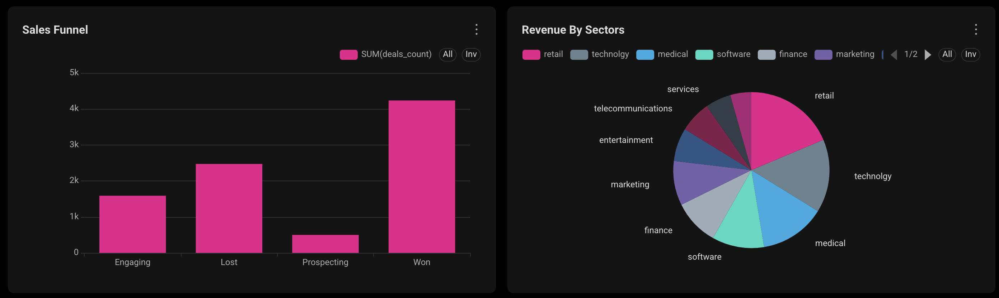

# B2B SaaS Sales Analytics & Data Pipeline (ClickHouse + dbt + Superset)

An end-to-end analytics engineering project demonstrating modern Data Warehouse (DWH) practices for a B2B SaaS CRM dataset. The pipeline extracts, cleans, models, tests, and visualizes sales performance metrics to optimize revenue tracking and sales funnel efficiency.

---

## 🏗 System Architecture

The project follows the **Medallion & Star Schema Architecture**:

1. **Storage Layer (ClickHouse Cloud):** High-performance columnar database hosting raw and modeled datasets.
2. **Transformation Layer (dbt):** 
   * **Staging (`stg_`):** Type casting, string cleaning (`trim`, `nullif`), and standardization.
   * **Marts (`fct_`, `dim_`):** Star Schema setup for efficient OLAP querying and BI integration.
3. **Data Quality Layer (dbt test):** Automated checks for `unique`, `not_null`, and `accepted_values` (pipeline integrity).
4. **BI & Visualization Layer (Apache Superset):** Executive dashboard displaying KPIs, sales funnel, agent performance, and sector distribution.

---

## ⭐️ Data Model (Star Schema)

* **Fact Table:**
  * `fct_deals`: Deals granularity with revenue (`close_value`), stage flags (`is_won`, `is_closed`, `is_prospecting`, `is_engaging`), and foreign keys.
* **Dimension Tables:**
  * `dim_sales_agents`: Managers, regional offices, and agent hierarchy.
  * `dim_accounts`: Company sectors, annual revenue, employee counts, and location.
  * `dim_products`: Product series and prices.

---

## 📊 Key Analytics & Insights Built-In

* **Revenue Metrics:** Total Revenue ($10M+), Average Deal Size ($2.36k), and Win Rate.
* **Funnel Conversion:** Tracking leads from `Prospecting` → `Engaging` → `Won` / `Lost`.
* **Sector Performance:** Revenue breakdown across `Retail`, `Technology`, `Medical`, and `Services`.
* **Agent Performance:** Top performing sales reps ranked by total won volume.

---

## 🛠 Tech Stack

* **Database:** ClickHouse Cloud (OLAP)
* **Transformation & Testing:** dbt-core + dbt-clickhouse
* **Business Intelligence:** Apache Superset
* **Version Control:** Git & GitHub
* **Environment:** Python 3.10+, VS Code

---

## 🚀 Quick Start & Reproduction

### 1. Repository Setup
```bash
git clone [https://github.com/YOUR_USERNAME/crm-sales-analytics.git](https://github.com/YOUR_USERNAME/crm-sales-analytics.git)
cd crm-sales-analytics
python3 -m venv venv
source venv/bin/activate
pip install dbt-clickhouse python-dotenv
```

### 2. Run dbt Pipeline
```bash
cd dbt_sales_analytics
dbt debug
dbt run
dbt test
```

---

## 📸 Dashboard Preview


